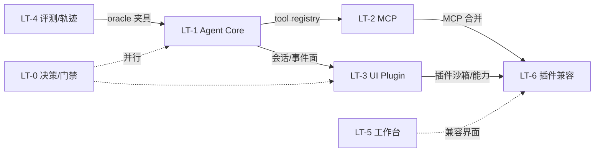

# 上游能力对齐：长任务改造计划

> **For agentic workers:** 本文件是 program-level 长任务清单，不是单个任务的逐步骤实现计划。每个长任务（LT）开工前，先按 `writing-plans` 技能单独产出该 LT 的 spec 与细粒度计划，再进入实现。步骤用 `- [ ]` 跟踪。

**Goal:** 把上游 `zai-org/ZCode` v3.18.2 中值得跟的产品能力，收敛成 6 个可独立交付的长任务 + 1 个决策/门禁轨道；每个 LT 都能在不破坏 Mode 现有产品边界的前提下独立验收。

**Architecture:** 后端按 Rust `crates/**` 单一所有者推进（Agent Core、MCP、插件宿主），前端按 `packages/ui` 的 renderer 能力推进（UI Plugin、工作台），工具链按 CLI `apps/mode-cli` 推进（评测/轨迹）。所有跨模块改动先定单一状态所有者、接口、事件顺序与幂等边界，再写代码。

**Tech Stack:** Rust（tokio / axum / serde / rmcp 方向）、Tauri v2、React 18 + TS 5、Zustand、SQLite、Node sidecar（第三方插件负载）。

**Spec / Inputs:**

- 上游公开产品资料：`README.md`、`docs/product-capability-map.md`、`Releases`、`docs/` 文件索引（**不读上游实现源码**）。
- [clean-room-policy.md](../specs/clean-room-policy.md)
- [tauri-rewrite-roadmap.md](./2026-10-09-tauri-rewrite-roadmap.md)
- [full-rust-rewrite.md](./2026-10-29-full-rust-rewrite.md)
- [agent-runtime-parity-matrix.md](../specs/agent-runtime-parity-matrix.md)
- [host-ownership-switch.md](../specs/host-ownership-switch.md)

## Global Constraints

- **clean-room**：新增/重写代码只从本仓库 spec、协议、测试、公开资料出发；不读、不粘贴、不翻译上游实现。对拍只记录输入输出与事件序列。
- **spec-first**：每个 LT 先落 spec，再写细计划，再实现；行为改动先补测试。
- **单一所有者**：每个可变状态只有一个所有者；Renderer 只保留草稿与 projection cache；不新增第二份队列、快照或派生态。
- **产品边界不回退**：官方账号/套餐/分享/市场/客户端配置/官方 MCP/官方闲时网关保持下线；无遥测、ARMS、OTLP、崩溃采集。
- **三平台**：Windows x64、macOS arm64、Linux x64 全程可构建；交互改动同时考虑桌面与手机 Web。
- **验证**：每个 LT 必须通过 `pnpm typecheck`、`pnpm lint`、`pnpm architecture:check --changed`，并执行本 LT 的验收场景；未执行的项如实标注。
- **不推送**：agent 只做本地提交，不执行 `git push`。

## Review Focus

以下是 spec 不会逐条写、但最容易被用户碰到的失败模式，每个 LT 的验收里必须有对应测试：

1. **双写/双队列**：Rust 运行时与 Node 运行时同时消费同一会话，出现重复事件或丢事件。
2. **恢复语义串线**：`desktop-continuous` 与 `web-remote-replayable` 的 snapshot/gap 语义混用，手机端重复或漏消息。
3. **插件越权**：UI 插件读到 Host DOM、凭据或未声明的网络；插件崩溃拖垮主界面。
4. **MCP 协议降级错误**：版本协商失败被当成成功，工具列表为空但不报错。
5. **评测污染**：轨迹/评测把凭据、真实用户数据或内部地址写进产物。
6. **布局状态双源**：工作台分栏/分组同时存在 UI store 与服务端事实两份权威。

## 长任务总览

| ID       | 长任务                          | 目标                                                               | 优先级 | 规模 | 依赖             | 主要落点                                                                        |
| -------- | ------------------------------- | ------------------------------------------------------------------ | ------ | ---- | ---------------- | ------------------------------------------------------------------------------- |
| **LT-1** | Agent Core 行为对齐与 Rust 收口 | Rust 运行时成为默认，行为与 TS oracle 等价                         | P0     | XL   | LT-4（夹具）     | `crates/agent-core`、`agent-tools`、`agent-process`、`agent-protocol`           |
| **LT-2** | MCP 协议现代化                  | dual-era、OAuth、apps/resource、输出预算、目录缓存、诊断           | P1     | L    | LT-1 C1          | `crates/mcp-sync-service`、CLI `runtime/methods/mcp.ts`、MCP 设置               |
| **LT-3** | UI Plugin 运行时                | renderer 插件页、显示模式、指针事件、后台执行、沙箱与权限          | P1/P2  | L/XL | 插件市场（已有） | `packages/ui/src/plugin-runtime`（新）、`packages/shared`、`crates/plugin-host` |
| **LT-4** | CLI 批量评测与轨迹记录          | 批量任务、脚本 provider、轨迹 JSONL、报告与回放                    | P0     | M    | 无               | `apps/mode-cli/packages/eval`（新）、CLI 命令、contracts                        |
| **LT-5** | 工作台与交互对齐                | 分栏、会话分组、任务搜索、find highlight、Plan Mode/审批细节       | P2     | M/L  | M4 UI 基础件     | `packages/ui/src/app-shell`、`packages/ui/src/store`、i18n                      |
| **LT-6** | 插件生态兼容层                  | Claude marketplace/triplet、hooks 兼容、managed settings、MCP 合并 | P2     | M    | LT-2、LT-3       | `packages/services/src/plugins`、`plugin-sync`、`workspace-hooks-service`       |
| **LT-0** | 决策与门禁（跨任务）            | Android/PWA、自建配置/分享通道、M2/M4/M5 收口门禁                  | P1     | S    | 无               | ADR + 门禁清单                                                                  |

## 依赖与波次



| 波次               | 并行长任务                         | 出口条件                                                 |
| ------------------ | ---------------------------------- | -------------------------------------------------------- |
| **Wave 0（现在）** | LT-4、LT-1 C1、LT-0 决策           | 评测命令可跑通脚本 provider；Rust 运行时所有权开关可回退 |
| **Wave 1**         | LT-1 C2–C4、LT-2                   | Oracle 夹具全绿；MCP 版本协商与 OAuth 夹具通过           |
| **Wave 2**         | LT-3、LT-5                         | UI 插件 demo 可安装运行；工作台 E2E 通过                 |
| **Wave 3**         | LT-6                               | Claude 插件导入 + hooks/managed settings + MCP 合并通过  |
| **Gate**           | M2 20 任务、M4 重合度清零、M5 签名 | 路线图阶段关闭条件                                       |

> 并行纪律：LT-1 与 LT-2 同时改 `agent-core` 时，tool registry 的修改由 LT-1 主导；LT-2 只新增 MCP 子模块与协议层，跨边界改动先走接口评审。

---

## LT-1｜Agent Core 行为对齐与 Rust 收口

**目标：** 新增 `crates/agent-server`（`app-server --stdio` 的 Rust 实现），以**进程级 drop-in** 接管 Agent 会话：协议面、事件面、工具面与 TS oracle 等价，并通过 M2 的 20 个真实模型任务。Node 运行时只保留显式回退，不再是默认所有者。

**现状差距（2026-11-16 核对）：** `crates/agent-core` 目前是 M2 的**行为切片**——6 个工具（Read/Write/Edit/Bash/TaskOutput/TaskStop）+ 脚本 provider + 最小 turn 循环；生产默认仍是 Node `mode.cjs`，`crates/agent-process` 只是 stdio 客户端与进程所有者。LT-1 不是“把 `agent-core` 接上”，而是补一个完整的 `app-server`：真实 provider、会话存储、上下文装配、压缩/记忆、恢复/目标与生态面。

**为什么是长任务：** 它不是“补几个函数”，而是 turn 状态机、上下文装配、压缩/记忆、流恢复、目标续跑、故障收口六件事同时收口；任何一件用兜底分支掩盖，都会在远程/手机恢复链路上放大。

**主要落点：**

- `crates/agent-core/src/{session,stream,tool,provider,command_inbox,permission,approval,rule_store,plugin_tools}.rs`（已有切片）
- **新** `crates/agent-server`：`app-server --stdio` 二进制、NDJSON 分帧、方法分派、反向请求、启动/存储门
- **新** `crates/provider-http`：真实模型流式适配（C1 先 OpenAI Chat Completions，C2 补 Anthropic Messages / Responses）
- **新** `crates/session-store`：CLI 会话库（`session` / `message` / `part` / `session_input` / `session_target` / `todo` / `local_setting` / `permission` 等），schema 以 `scripts/sqlite-schema-baseline.json` 的 `session-store` 为契约
- `crates/agent-tools/`（工具生命周期与产物）
- `crates/agent-protocol/` 与 `packages/shared/src/mode-protocol/index.ts`（帧与类型）
- `crates/agent-process/`（spawn/stdio/provider source；保持客户端不变，靠命令解析切换 Node/Rust）
- `crates/rpc-host/`、`crates/host-channels/src/mode_agent.rs`（路由/频道 facade，不持有 turn 状态）
- 开关与文档：`docs/specs/host-ownership-switch.md`、`docs/specs/tauri-agent-runtime.md`
- 新 spec：`docs/specs/agent-core-parity.md`；C1 计划：`docs/plans/2026-11-16-lt1-c1-rust-agent-server.md`

**状态所有者与接口：**

```text
Renderer（只保留草稿与 pending overlay）
   │ session/send（intent）
   ▼
Host rpc-host（路由/租约，不持有 turn 状态）
   │ stdio / RPC frame
   ▼
agent-process（spawn/持有进程；命令解析决定 Node 还是 Rust）
   ├─ Node mode.cjs（oracle / 显式回退）
   └─ Rust agent-server（目标默认）
        ├─ agent-core（唯一所有者：turn / session / CommandInbox）
        ├─ agent-tools（工具生命周期）
        ├─ provider-http（模型流）
        └─ session-store（会话库单一写者）
   ▼
ProductProjection / SessionEvent（单一序列）
```

不变量：同一 workspace/会话只有一个运行时所有者；`CommandInbox` 串行准入；stale run 拒绝；终态事件恰好一次；Renderer 不保留第二份已接受队列；同一时刻只有一个进程写 `db.sqlite`。

**检查点：**

- **C1 最小闭环（vertical slice）**：Rust `agent-server` 可被 `agent-process` 拉起；真实 provider 跑通文本 + `Read`/`Write`/`Edit`/`Bash`；`session/create|send|subscribe|read|messages|list|close|resume` 与三个 setter 可用；会话落 `db.sqlite` 并能恢复；显式开关切换到 Rust、去掉开关回退 Node；不产生双 owner。**验收 = oracle 夹具（脚本 provider）+ 真实 provider smoke + 创建/关闭/恢复 + 无 Node 子进程。**
- **C2 上下文、记忆与压缩**：context assembly（系统提示/模式/工具 schema/工作区事实）、compact 阈值与摘要落库、memory recall/write、token 预算与上下文窗口；会话快照与 TS 的 `settings/projection/runtime` 形状对齐。
- **C3 流恢复、目标与故障收口**：断线/重试/重放不重复 delta；`streamRecovery.updated`；goal/target continuation 的停止条件与用户中断；后台任务通知 turn；工具/provider/超时/取消的终态各恰好一次；子代理基础面。
- **C4 生态面与默认翻转**：MCP、Skills、Plugins、Subagents、Workflows、附件与 v4 会话帧进入 Rust 运行时（消费 LT-2 / LT-6，不重复实现）；20 个真实任务通过；默认运行时翻到 Rust，Node 只在显式回退时启动。

**验收场景：**

1. `packages/desktop/tests/agent-runtime-oracle/fixtures/*.json` 在 Rust `agent-server` 回放，`SessionEvent` 类型、顺序、工具调用序列、文件快照与终态统计按 `tauri-agent-runtime.md` 的三层口径一致。
2. C1 真实 provider smoke：一个 OpenAI 兼容端点完成“文本 → Read 工具 → 最终回答”，事件流、usage、消息落库可复现；第二个 Anthropic Messages 端点在 C2 验收。
3. 会话生命周期：create → send → close → resume → list/read/messages 往返后，`session`/`message`/`part` 行与 schema 基线一致，重启后不丢。
4. 切换/回滚：`MODE_AGENT_SERVER_COMMAND` 指向 Rust 二进制时只拉起 Rust；移除后回退 Node；同一 workspace 连续两次启动只有一个 Agent 子进程，退出无孤儿。
5. `host-ownership-switch.md §7` 的 20 个真实任务全部通过（C4）；失败项有根因与修复记录，不以“超时”掩盖。
6. 并发发送、取消、重连、stale run：准入顺序、幂等键、拒绝原因可观测。
7. `desktop-continuous` 与 `web-remote-replayable` 在同一 owner 下产生一致的 projection；手机端 gap/snapshot 恢复不重复、不丢失。
8. 性能不回退：turn 首事件延迟、工具往返、内存占用与基线对比有记录。

**依赖：** LT-4 提供轨迹/oracle 夹具；LT-2 提供 MCP 协议面（C4）；LT-6 提供插件兼容（C4）。

**非目标：** 不新增 Agent 产品功能；不改 TUI/IM/Web 的宿主形态；不为兼容而保留第二套并发队列；不在 C1 接 MCP/Skills/Plugins/Subagents/Workflows。

**完成定义：** spec 合并；C1–C4 全部勾选；20 任务记录入库；`typecheck/lint/architecture:check` 与 `cargo clippy -D warnings` 通过；Rust 默认开关与 Node 回退路径均有测试；`db.sqlite` 单写者不变量有测试。

---

## LT-2｜MCP 协议现代化

**目标：** 把用户自配 MCP 的协议面补齐到现代 MCP：版本协商、OAuth、apps/resource、工具输出预算、异步目录缓存、不可达诊断；配置/同步仍由单一所有者维护。

**主要落点：**

- `crates/mcp-sync-service/`（配置同步与校验）
- `packages/services/src/mcp-sync/`（TS 侧迁移期适配）
- `apps/mode-cli/packages/core/src/runtime/methods/mcp.ts`（Agent 侧连接/工具目录）
- `crates/agent-core/src/tool.rs`（只消费 registry；不复制 MCP 客户端）
- MCP 设置与诊断：`packages/ui/src/settings/McpSettingsSection.tsx`
- 新 spec：`docs/specs/mcp-modern-protocol.md`；更新 `docs/specs/mcp-sync-service.md`

**状态所有者与接口：**

```text
mcp-sync-service（配置事实所有者）
        │ snapshot(revision)
        ▼
agent runtime（连接/工具目录所有者） ── tools/call ──> MCP server
        ▲
        │ token
OAuth token store（凭据所有者；不落日志）
```

不变量：配置只有一个写入口；连接与工具目录由 agent runtime 持有；token 只从凭据存储读取；缓存按 `serverId + revision` 失效；不可达时返回结构化诊断，不重试风暴。

**验收场景：**

1. 2024-11-05 / 2025-03-26 / 2025-06-18 三个版本的夹具 server 协商正确；版本不匹配 fail-closed 并给出诊断。
2. OAuth PKCE、刷新、撤销全链路；token 不出现在日志/轨迹/错误文案。
3. `ui://` resource MIME 在预览面板正确渲染；未知 MIME 走安全降级。
4. 工具输出超过预算时产生结构化截断标记与摘要，不静默丢内容。
5. 目录缓存 TTL、server 变更失效、stale 读行为可测。
6. 不可达/server stderr/配置兼容问题在设置页可见，且不触发无限重试。
7. Rust 与 TS 的配置投影逐字段对拍。

**依赖：** LT-1 C1（运行时所有权）；与 LT-1 C2 并行时只新增 MCP 子模块。

**非目标：** 不恢复官方 MCP 凭证；不把 MCP 客户端复制到 Renderer；不为第三方 server 做特例兜底。

**完成定义：** 新 spec 合并；三版本 + OAuth + 预算 + 缓存 + 诊断夹具全绿；设置页真机走查；`typecheck/lint/architecture:check` 通过。

---

## LT-3｜UI Plugin 运行时

**目标：** 增加 renderer 级 UI Plugin 能力：插件页、显示模式、指针事件、后台执行、生命周期、权限与沙箱；与现有插件市场/安装链路复用，不复制一套插件管理。

**主要落点：**

- 新 `packages/ui/src/plugin-runtime/`（renderer 宿主、iframe/worker 沙箱、生命周期）
- 新 `packages/shared/src/plugin-api.ts`（manifest、capability、postMessage 协议）
- `packages/ui/src/app-shell/`（side pane / full page / dialog 挂载点）
- `crates/plugin-host/src/{manifest,protocol,supervisor}.rs`（manifest 校验、能力声明、进程监督）
- `packages/services/src/plugins/`、`plugin-sync/`（安装/更新/卸载事实）
- 新 spec：`docs/specs/ui-plugin-runtime.md`

**状态所有者与接口：**

```text
plugin services（已安装事实所有者）
        │ manifest + capability
        ▼
plugin-host（校验/监督）
        │ capability grant
        ▼
renderer plugin-runtime（UI 运行态所有者）
        │ postMessage
        ▼
Plugin iframe / Worker（第三方负载）
```

不变量：插件不接触 Host DOM、cookie、凭据；网络只能走声明能力；能力授予显式且可撤销；插件崩溃只影响自己的宿主；UI 运行态不写回已安装事实。

**检查点：**

- **C1 契约**：manifest schema、版本兼容、capability 列表、entry、display modes、生命周期事件。
- **C2 沙箱**：iframe/worker 隔离、CSP、消息白名单、超时与崩溃隔离。
- **C3 显示模式**：side pane / full page / dialog；指针事件、主题、i18n、响应式。
- **C4 后台执行**：显式授权、配额、取消、退出清理，无僵尸进程。
- **C5 安装/更新**：本地目录与市场源；版本回滚；卸载清理。
- **C6 Demo**：一个白板/画布类插件在桌面与手机 Web 跑通，作为验收样例。

**验收场景：**

1. Demo 插件安装后可在三种显示模式打开；切换主题/语言不破版；关闭后无残留。
2. 插件尝试读取宿主 DOM、cookie、凭据或未声明网络时被拒绝，且错误可见。
3. 插件崩溃/超时不拖垮主界面；宿主可重载插件。
4. 后台执行有明确授权提示、配额与取消；退出应用无僵尸。
5. 更新/回滚保留插件数据；卸载清理按 spec 执行。
6. 安全评审记录：威胁模型、权限矩阵、逃逸测试。

**依赖：** 现有插件市场/安装链路；LT-6 复用本 LT 的沙箱与能力模型。

**非目标：** 不把插件代码 `eval` 进 renderer 主上下文；不做无沙箱的“原生 UI 插件”；不重写第三方插件负载。

**完成定义：** 新 spec 合并；C1–C6 勾选；Demo 插件 E2E；安全评审通过；`typecheck/lint/architecture:check` 通过。

---

## LT-4｜CLI 批量评测与轨迹记录

**目标：** 给 CLI 增加 `eval` 与轨迹记录：批量任务、脚本 provider、模型对比、pass@k、成本/延迟统计、轨迹 JSONL 导出与回放；为 LT-1 提供可复现的 oracle 夹具。

**主要落点：**

- 新 `apps/mode-cli/packages/eval/`（suite、runner、report、replay）
- `apps/mode-cli/packages/cli/`（命令注册与参数）
- `apps/mode-cli/packages/contracts/`（轨迹 schema、报告 schema）
- `crates/agent-core/`（只通过稳定接口消费；不复制运行时）
- CI：opt-in job，预算上限，默认门禁不跑真实网络
- 新 spec：`docs/specs/cli-eval-trajectory.md`

**状态所有者与接口：**

```text
eval CLI（suite/报告所有者）
   │ 提交任务
   ▼
agent runtime（执行所有者，与产品同一套）
   │ 事件/工具/turn
   ▼
trajectory store（轨迹单一写者）
   │
   └──> report / replay（只读）
```

不变量：不新建第二套 Agent 运行时；脚本 provider 结果确定；轨迹默认脱敏；报告不写入凭据、真实用户数据、内部地址。

**验收场景：**

1. `mode eval run <suite>` 对脚本 provider 逐字节确定性通过；重复运行结果一致。
2. 真实 provider 跑通小样本；报告含 pass/fail、tokens、成本、时长、工具调用序列。
3. 轨迹 JSONL 可回放为 LT-1 的 oracle 夹具；schema 版本化。
4. 脱敏测试：API key、token、用户路径、内部域名不出现。
5. CI opt-in job 有预算上限与超时；默认 `verify` 不依赖网络。
6. 任务级 diff：同一 suite 两次运行的差异可定位到 turn/tool。

**依赖：** 无；越早开始越好，但轨迹 schema 要与 LT-1 的 oracle 格式对齐。

**非目标：** 不做在线评测平台；不把评测结果当产品遥测；不在默认 CI 跑真实模型。

**完成定义：** 新 spec 合并；脚本 provider 确定性测试；轨迹回放接入 LT-1；CI opt-in job 跑通；`typecheck/lint/architecture:check` 通过。

---

## LT-5｜工作台与交互对齐

**目标：** 补齐上游已公开的工作台体验：分栏、会话分组、任务搜索、find highlight、侧栏顺序、Plan Mode/审批/elicitation 的边界行为；不改变现有状态所有者。

**主要落点：**

- `packages/ui/src/app-shell/`（`WorkspaceShellLayout`、side pane、split pane）
- `packages/ui/src/`（任务列表、分组、搜索、find highlight）
- `packages/ui/src/store/`（视图状态）
- `packages/ui/src/i18n/locales/{zh-CN,en-US}.ts`
- `DESIGN.md`（布局与交互规范）
- 新 spec：`docs/specs/workbench-ux-parity.md`

**状态所有者与接口：**

```text
UI store（视图状态所有者：分栏尺寸、折叠、搜索词、高亮）
   │ intent
   ▼
services（事实所有者：会话、任务、分组归属）
```

不变量：分组归属/会话事实不在 UI 复制；分栏尺寸与折叠只属于 UI store；搜索/高亮是投影，不写回事实；桌面与手机 Web 共用语义、布局各自适配。

**验收场景：**

1. 分栏打开/关闭/拖拽/持久化；键盘可达；重启后恢复。
2. 会话分组拖拽、排序、折叠；与任务列表事实一致，无重复状态。
3. 任务搜索与 find highlight 在大列表下可用；无卡顿回归。
4. Plan Mode/审批/elicitation 的状态转换、取消、自动解决符合 spec。
5. 桌面与手机 Web 的主题、i18n、响应式走查通过。
6. E2E：分栏、分组拖拽、搜索高亮、Plan Mode 切换。

**依赖：** M4 UI 基础件；与 LT-3 的插件 pane 挂载点协调；与 LT-6 的兼容设置页协调。

**非目标：** 不重做 UI 设计系统；不引入第二份布局/分组持久化；不为桌面牺牲手机 Web。

**完成定义：** 新 spec 合并；E2E 场景通过；`typecheck/lint/architecture:check` 通过；看屏验收记录。

---

## LT-6｜插件生态兼容层

**目标：** 让 Claude Code 生态的插件/技能/命令/MCP 能在 Mode 中导入、安装、运行、更新；hooks 信任与 managed settings 不被插件覆盖；与 LT-2/LT-3 的 MCP、沙箱能力合并。

**主要落点：**

- `packages/services/src/plugins/`、`plugin-sync/`（安装/更新/回滚）
- `packages/ui/src/settings/ExternalAgentImportDialog.tsx`、`MigrationSection`（导入面）
- `crates/plugin-host/`（manifest/能力/监督）
- `crates/workspace-hooks-service/`（hook 信任/拒绝）
- `crates/mcp-sync-service/`（插件 MCP 合并）
- `packages/ui/src/settings/`（managed settings 展示）
- 新 spec：`docs/specs/plugin-compat.md`；更新 `plugin-host.md`、`plugin-sync-service.md`、`workspace-hooks-service.md`

**状态所有者与接口：**

```text
plugin services（安装事实）
   │
   ├──> plugin-host（沙箱/能力）
   ├──> workspace-hooks-service（hook 信任）
   └──> mcp-sync-service（MCP 配置合并）
```

不变量：managed settings 不可被插件覆盖；hook 信任决定不可被插件改写；同名工具/MCP 冲突有确定性策略；更新/回滚保留用户数据。

**验收场景：**

1. 导入一个 Claude Code marketplace 插件（含 skills/commands/hooks/MCP），安装后可运行。
2. triplet 插件（plugin + MCP + skill）能力映射正确；缺依赖时给出可诊断错误。
3. hooks 信任/拒绝语义正确；被拒绝的 hook 不执行且可见。
4. managed settings 优先级高于插件设置；插件无法绕过。
5. 插件 MCP 与用户 MCP 合并；冲突策略可测；工具名不重复。
6. 更新/回滚/卸载保留用户数据；清理范围符合 spec。
7. 与 LT-3 沙箱/权限模型一致；无越权路径。

**依赖：** LT-2（MCP 合并）、LT-3（沙箱/能力）；LT-5 的兼容设置页可并行。

**非目标：** 不改写第三方插件代码；不做无信任模型的自动执行；不恢复官方市场 CDN。

**完成定义：** 新 spec 合并；导入/运行/更新/回滚全链路 E2E；hooks/managed settings 安全测试；`typecheck/lint/architecture:check` 通过。

---

## LT-0｜决策与门禁（跨任务）

**目标：** 用时间盒处理三个产品决策，并把路线图门禁集中到一处，避免长任务扩面时失去收口。

**决策项（每项产出 ADR，时间盒 1 周）：**

1. **Android 原生 vs PWA**：上游有 `packages/android`；Mode 现有移动 Web 远控。评估 WebView 壳、推送、后台、远控体验与维护成本，决定是否做原生壳。
2. **自建客户端配置/更新通道**：官方配置源已下线；仅在需要灰度/强制更新时自建，不做默认功能。
3. **自建对话分享**：分享已按产品边界下线；若要恢复，只能自建分享服务，不接官方后端。

**门禁清单：**

- M2：20 个真实模型任务通过（LT-1 C4）。
- M4：`pnpm verify:self-developed` 重合度清零；UI 看屏验收；Rust 台账收口。
- M5：三平台签名/公证、EOL 公告、升级链路真机验证。
- 每个 LT：`pnpm typecheck`、`pnpm lint`、`pnpm architecture:check --changed`、本 LT 验收场景。

**非目标：** 不在门禁未过时把长任务标成“完成”；不用新功能掩盖已有失败。

---

## 统一交付与回滚

| 项    | 要求                                                                        |
| ----- | --------------------------------------------------------------------------- |
| Issue | 每个 LT 开工前创建/认领 Issue，PR 正文写 `Closes #<编号>`                   |
| spec  | 每个 LT 一份新 spec（或更新既有 spec），先评审再实现                        |
| 分支  | 一个 LT 一个分支；跨 LT 改动先拆接口，不混提                                |
| 开关  | LT-1 所有权、LT-3 插件运行时、LT-2 协议面都要有显式开关；默认值 fail-closed |
| 回滚  | 数据不迁移或迁移可逆；保留 Node 运行时到 LT-1 门禁通过；插件 API 版本化     |
| 观测  | 只记录本地日志与用户主动导出；不新增遥测出口                                |
| 文档  | 每个 LT 完成后更新 README/AGENTS 相关段落与路线图进度                       |

## 下一步

1. 先开 **LT-4**（评测/轨迹）与 **LT-1 C1**（所有权开关），两者互不阻塞，且直接服务 M2 验收。
2. 同时启动 **LT-0** 的三个时间盒决策，避免 Android/配置/分享在长任务中途反复摇摆。
3. LT-1 C1 完成后，按依赖图启动 **LT-2**；LT-3/LT-5 在 M4 UI 基础件稳定后进入。
4. 每个 LT 开工时，用 `writing-plans` 产出该 LT 的 spec 与细粒度计划，再按 `executing-plans` 或 `subagent-driven-development` 执行。
