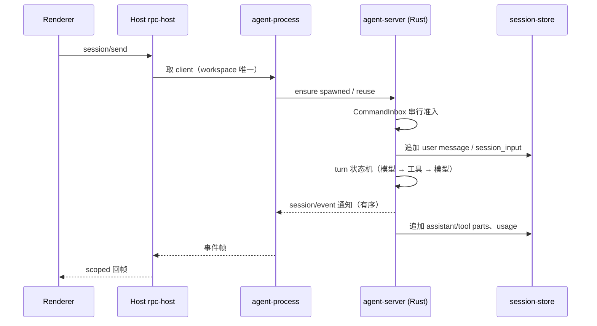

# Spec：Agent Core 行为对齐与 Rust 收口（LT-1）

状态：**已批准方向（2026-11-16，用户选择「LT-1 全量」）**；C1 已交付（2026-11-17，Task 10 收口——三层回放与差异登记见 `tauri-agent-runtime.md` §C1 差异登记，验收记录见本文件 §9.2）。
关联：`docs/plans/2026-11-16-upstream-capability-long-tasks.md`（LT-1）、
`docs/plans/2026-11-16-lt1-c1-rust-agent-server.md`（C1 计划）、
`docs/specs/clean-room-policy.md`、`docs/specs/tauri-agent-runtime.md`、
`docs/specs/host-ownership-switch.md`、`docs/specs/agent-process.md`、
`docs/specs/session-read-group.md`、`docs/specs/session-write-group.md`、
`docs/specs/sqlite-schema-gate.md`、`docs/specs/mode-protocol-client.md`。

## 1. 目的

把 Agent 会话运行时从 Node `mode.cjs` 迁到 Rust，并保证：

1. **协议 drop-in**：Rust 进程在同一个 `app-server --stdio` 协议边界上工作，
   `crates/agent-process` 与 `host-channels/mode_agent` 不需要改协议；
2. **行为等价**：按 `tauri-agent-runtime.md` 的三层口径（工具调用序列 / 文件快照 /
   事件流）与 TS oracle 对拍；不完全等价的字段必须显式登记；
3. **单一所有者**：同一 workspace 同一时刻只有一个 Agent 进程；同一会话只有一个
   turn 状态机；同一 `db.sqlite` 只有一个写者；
4. **可回滚**：显式开关切到 Rust；去掉开关回到 Node；切换期间不双写、不丢事件；
5. **可验收**：C1 先交付最小闭环，C4 通过 20 个真实模型任务后才把默认运行时翻到 Rust。

**不是**在本 spec 里新增 Agent 产品功能。LT-1 只改变「谁执行」，不改变「执行什么」。

## 2. 目标架构

### 2.1 进程边界

新增 `crates/agent-server`，产出 `mode-agent` 二进制（名称由打包决定），实现
`app-server --stdio`：

```text
Renderer（草稿 / pending overlay）
   │ session/send（intent）
   ▼
Host rpc-host（路由/租约；不持有 turn 状态）
   │ stdio / RPC 帧
   ▼
agent-process（spawn / 进程树 / stderr / 空闲回收；协议客户端不变）
   ├─ Node `mode.cjs`（oracle / 显式回退）
   └─ Rust `agent-server`（目标默认）
        ├─ agent-core（turn / session / CommandInbox 唯一所有者）
        ├─ agent-tools（工具）
        ├─ provider-http（模型流）
        ├─ session-store（`db.sqlite` 单写者）
        └─ agent-protocol（帧/事件）
   ▼
ProductProjection / SessionEvent（单一序列）
```

选择 drop-in 而不是「壳内直调 `agent-core`」的理由：

- 既有的 102/115 方法、事件桥、健康面、进程回收都能复用，切换成本最低；
- oracle 与 Rust 在同一 stdio 边界上，黑盒对拍不需要第二套驱动；
- 回滚只是命令解析变化，不需要回滚壳内路由；
- 远程/SSH/WSL/Docker 主机同样受益（它们也需要一个可执行 Agent）。

**不做**：把 `agent-core` 直接嵌进 Tauri 壳、另建一套壳内 RPC 面；这会产生第二条
协议路径与第二份事件投影。

### 2.2 关键组件

| 组件                       | 职责                                                          | 不负责                           |
| -------------------------- | ------------------------------------------------------------- | -------------------------------- |
| `crates/agent-server`      | stdio 分帧、方法分派、反向请求、启动/存储门、进程生命周期     | turn 语义、工具语义、存储 schema |
| `crates/agent-core`        | turn 状态机、`CommandInbox`、上下文装配、压缩/记忆、恢复/目标 | 网络/进程/sqlite 细节            |
| `crates/agent-tools`       | 工具纯函数与产物                                              | 会话状态、权限持久化             |
| `crates/provider-http`     | OpenAI/Anthropic 流式适配、工具调用累积、usage 映射           | provider 配置解析、账号/余额     |
| `crates/session-store`     | `db.sqlite` schema 兼容、session/message/part/usage 读写      | turn 状态、事件序列              |
| `crates/agent-process`     | 拉起/持有/回收进程、stdio 客户端、provider 配置交付           | 运行时语义                       |
| `host-channels/mode_agent` | 频道 facade → 控制面方法                                      | 运行时内部状态                   |

## 3. 所有权与事件顺序

### 3.1 会话所有权



不变量：

1. **一个 workspace 一个 Agent**：key = `workspaceIdentity?.trim() || workspacePath`
   （沿用 `AgentRuntimeRegistry`）。
2. **一个会话一个 turn 状态机**：`CommandInbox` 是唯一准入队列；Renderer 只保留未提交
   草稿与 pending optimistic overlay。
3. **请求与事件走同一下行路径**：`agent-server` 不直连 Renderer。
4. **终态恰好一次**：`turn.completed` / `turn.failed` 每个 turn 只发一次。
5. **库级写者由 SQLite 串行化**（2026-11-17 控制器裁决 (a)）：不再要求「同一
   `db.sqlite` 只允许一个 Agent 进程」。每个 workspace 仍由 `AgentRuntimeRegistry` /
   `agent-process` 保证只有一个合法 owner；多个**合法 owner** 的 workspace 进程可以
   同时打开同一会话库，写操作由 SQLite WAL + `busy_timeout` 的 `BEGIN IMMEDIATE`
   串行化。C1 **不**创建 `<db>.agent-write.lock` 之类的进程独占锁：
   - Node 运行时不识别 Rust 的锁文件，独占锁既挡不住 Node 重叠，又会误伤第二个
     workspace；
   - 真正的双写风险由「一个 workspace 一个 Agent」的进程调度兜底；
   - 数据库被另一连接长时间占用时，写事务在 `busy_timeout` 之后报 `storage_locked`，
     不静默丢写。
   oracle 对拍仍使用隔离数据根，不与 Rust 运行时共享库。

### 3.2 双链路

- `desktop-continuous`：实时 push；Rust `agent-server` 只负责产生有序事件，
  **不做快照/队列**。
- `web-remote-replayable`：snapshot + gap 恢复归 Host/relay；Rust 只透传
  `deliveryKind` 与 `seq`。
- 两条链路消费同一个 `ProductProjection`，但恢复语义不互相扩散。

## 4. 检查点与范围

| 检查点                  | 交付                                                                                                                                                                   | 明确不做                                                                                                             |
| ----------------------- | ---------------------------------------------------------------------------------------------------------------------------------------------------------------------- | -------------------------------------------------------------------------------------------------------------------- |
| **C1 最小闭环**（已完成 2026-11-17） | `agent-server` + OpenAI Chat Completions + `session-store`（已有数据根）+ 6 个工具 + 权限 + create/send/subscribe/read/messages/list/close/resume + setter + 切换/回滚 | MCP/Skills/Plugins/Subagents/Workflows/附件/v4 帧；compact/memory/goal；Anthropic/Responses；fresh-install migration |
| **C2 上下文/记忆/压缩**（已完成 2026-11-18） | 上下文装配、compact、memory、token 预算、会话快照齐全；Anthropic Messages / OpenAI Responses；C2 夹具回放 9/9 全绿（T8 对拍 harness），差异登记见 `tauri-agent-runtime.md` §C2.8 | 生态面；自动 compact 阈值（未观察）；memory 写路径（extraction 子代理，未观察）                                     |
| **C3 恢复/目标/故障**（已完成 2026-11-19） | stream recovery/retry（`mode-api-retry` 单源）、goal/target 续跑（`session_target` 单一事实源）、后台通知（空闲开 turn / 忙时合并 / 前台工具窗口丢弃）、`session/subagents` 只读面、终态恰好一次；C3 夹具回放 11/11 全绿（`replay-c3.mts`），差异登记见 `tauri-agent-runtime.md` §C3；C1 38/38 + C2 11/11 保持 | 生态面；goal 预算/轮次上限（协议无入口，未观察）；spawn/child runtime（C4）                                        |
| **C4 生态与默认翻转**（T1–T5 完成；2026-11-20 真机 headless 验收补齐后 19 PASS / 1 PARTIAL / 0 FAIL） | MCP/Skills/Plugins/Subagents/Workflows/附件/v4 已接入 `agent-server`；T6 补齐 TodoWrite/TodoRead、ExitPlanMode + plans、fileChanges/fileRewindPreview、backgroundBashOutput；验收修复 workflow events seq0 与 resync/unsubscribe 参数形状（`ac552018e`）；差异登记见 `tauri-agent-runtime.md` §C4 | 唯一 PARTIAL：任务 16 远程/手机重连（需真机；sessions-index live 增量未接）；**默认 Rust 翻转未执行**（§9.3 门禁未满足）；C4 replay driver 与真实端点 smoke 待补 |

C1 的详细任务见 `docs/plans/2026-11-16-lt1-c1-rust-agent-server.md`。

## 5. 行为契约

### 5.1 会话生命周期

C1 必须实现：

| 方法                                               | 语义                                                                                                                 |
| -------------------------------------------------- | -------------------------------------------------------------------------------------------------------------------- |
| `session/create`                                   | 严格解析 `SessionCreateParams`；返回完整 `SessionStateSnapshot`；落 `session` + 初始 `session_entry`。`session_input` 只在 deferred/排队输入时写；create + immediate send 观察到 **0 行**（2026-11-16 oracle 夹具 `session-lifecycle`） |
| `session/send`                                     | 严格解析；`CommandInbox` 准入；返回 `{sessionId, accepted:true, stateRevision}`；turn 异步执行                       |
| `session/subscribe`                                | 先订阅通知再发请求；返回 replay + 可选 snapshot；live 只投递本会话                                                   |
| `session/read`                                     | 从活跃 runtime 或 `session-store` 冷读；返回快照                                                                     |
| `session/messages`                                 | 按 `afterMessageId`/`limit` 返回 `{info, parts}`；part 13 种按协议镜像。无 `after` 且给 `limit` 时取**最新** N 条（与 Node store 的 `limit` 语义一致），结果仍按升序返回 |
| `session/list`                                     | `includeArchived` 恒发；`limit`/`sessionIds` 缺省省略。按 workspace 的 `directory` 精确匹配；`project_id`（`proj_` + 归一化 cwd）不作为 workspace key，避免跨工作区串列表 |
| `session/close`                                    | 关闭 runtime；`persistence` 语义按参数；不删除事实                                                                   |
| `session/resume`                                   | 冷会话恢复为活跃 runtime；返回快照                                                                                   |
| `session/setModel` / `setThoughtLevel` / `setMode` | 更新 runtime 设置并返回快照；`persistAsWorkspaceLastUsed` 按协议省略/下发                                            |
| `session/compact`                                  | C2 已实现：异步受理（`{response:"", snapshot, compact:{state:"accepted"|"already_running", inputId}}`）；`expectedRevision` 冲突 `-32009`、prompt 运行中 `-32010`；并发第二单 `already_running` / 排队后 `accepted→skipped`；失败异步 `turn.failed`（契约 §1）。 |
| `session/goal`                                     | C3；C1 返回 `unsupported_method`（显式）                                                                             |

未知方法统一 `-32601 Method not found`，频道 facade 映射为 `unsupported_method`；
**不返回空结果**。

### 5.2 turn 状态机

一次 turn 的顺序（C1 子集）：

```text
accepted → turn.started → model.streaming×N
  →（可选）tool.updated(scheduled/started/result|error/batch)
  →（可选）下一轮 model.streaming
  → turn.completed | turn.failed
```

- `turnNumber` 首个为 0，之后 +1（沿用已观察值）。
- `model.streaming` 的 delta 顺序即 provider 输出顺序；工具入参只出现在
  `kind:"tool_call"`（`scheduled` 带 `inputOmitted:true`）。
- 工具批次编排（2026-11-17 控制器裁决 (b)；C1 按观察收口）：
  1. **先为整批每个调用发 `scheduled`**（调度顺序即模型给出的顺序）；
  2. 然后**串行**执行每个调用：执行前立刻发 `started`（未注册/入参非法/权限拒绝等
     不执行的调用没有 `started`），执行结束立刻发 `result` 或 `error`；
  3. 整批结束后发唯一的 `batch`（写类工具成功时再发 `checkpoint.created`）。
  C1 **不**并行执行工具调用，登记为 C1 差异（`tauri-agent-runtime.md` §C1.5-6）。
  完成事件的顺序本就不属契约（spec §3 无序组②），串行执行只是该契约的一个实现；
  多调用批次的 oracle 行为夹具尚未录制，登记为回放缺口。
- `session.updated` / `streamRecovery.updated` 在 C1 可以缺省，但必须在 C1 验收记录里
  登记为「未产出」，不能伪造。
- C1 不产出 `compact` / `goal` / `subagent` / `workflow` 相关事件。

### 5.3 工具与权限

- C1 工具：`Read`、`Write`、`Edit`、`Bash`、`TaskOutput`、`TaskStop`
  （`crates/agent-tools` 已有；新增工具必须先有 oracle 观察）。
- 权限：沿用 `agent-core` 的 `evaluate` + 三态响应（`allow_once` / `allow_project` /
  `deny`）；`allow_project` 写 `local_setting`（与既有 Rust `SqliteRuleStore` 同表）。
- 工具错误：`tool.updated(kind:"error")`，`error.type/message/code` 按协议；
  未注册工具在 `scheduled` 后直接 `error`，没有 `started`。
- 工具产物：`<dataRoot>/.mode/cli/exec/<sessionId>/<toolCallId>-stdout.log`（已有语义）。

### 5.4 事件与协议

- 事件信封复用 `agent_protocol::session_event::SessionEvent`；`eventId`/`sessionId`/
  `turnId`/`seq`/`timestamp`/`deliveryKind`/`type`/`payload` 严格。
- C1 只产出已建模类型；其余类型不编造。
- 反向请求：`session/requestRuntimePreferences`（每运行时一对：物化时
  `runtime-materialization` + 首个 turn 前 `user-execution`，Task 10 对齐 contract §2.2；
  应答/超时回退默认）、`interaction/requestPermission`（三态）；未注册反向请求回
  `-32601`。
- `startup/storageState`：启动时按 `agent-process` 的存储门语义发 checking/ready/failed；
  `supportsStorageStartup` 与现有命令解析一致。

### 5.5 持久化与 schema

- 数据库：`{dataRoot}/.mode/cli/db/db.sqlite`（CLI 布局）。
- C1 只接**已由 Node 迁移完成**的数据根；若迁移账本缺失/不匹配，fail-closed 报错，
  不静默建表。C2 再实现 fresh-install migration。
- C1 读写表：`session`、`message`、`part`、`session_entry`、`session_input`、
  `session_target`、`todo`、`local_setting`、`permission`、`model_usage`、
  `turn_usage`、`tool_usage`。`session_input` 只在输入被排队/deferred 时出现；
  immediate send 不写行（oracle 观察，见 `agent-server-c1-contract.md` §3.5）。
- `message.data` / `part.data` 的 JSON 形状以 `agent_protocol::message` 镜像与
  `session-store` 基线为准；C1 先录 oracle 的写入夹具，再按夹具断言。
- 事务：一个 turn 的 user message + parts 在同一事务；assistant/tool parts 按事件
  增量写入；终态更新 session/usage 在同一事务。失败回滚到 turn 前，不留下半截消息。
- 库级写者（2026-11-17 控制器裁决 (a)）：**不**使用 `<db>.agent-write.lock` 进程独占锁。
  多个合法 owner 的 workspace 进程（以及 Node 回退路径）可以打开同一 `db.sqlite`；
  写事务用 `BEGIN IMMEDIATE` + `busy_timeout`，由 SQLite/WAL 串行化。`busy_timeout`
  耗尽时写操作报 `storage_locked`（`StoreError::code()`），不静默丢写。进程级的
  「一个 workspace 一个 Agent」由 `AgentRuntimeRegistry` / `agent-process` 保证；
  oracle 对拍使用隔离根。schema 门（必需表 + `schema_migration` 账本）保持不变，
  仍是 fail-closed。
- 冷物化（create-on-existing / resume / 重启）必须从库内事实恢复 `Session` 的模型
  历史（user / assistant / tool result）、`FileState`（已读路径与去重键）以及 turn
  计数器；turn id 由持久化的最大序号 +1 继续分配，避免 `turn_usage` 主键冲突。
- 每个 assistant 步骤的行内 `tokens` 是该步骤对应**模型请求**的 usage（工具调用步骤
  记调用请求的用量，收尾步骤记收尾请求的用量），不是 turn 聚合值。

### 5.6 provider 适配

- C1：OpenAI Chat Completions 流式（`stream:true`）；解析 SSE `data:` 行、`[DONE]`、
  工具调用 delta（按 index/id 累积）、usage；错误映射为 `turn.failed`。
- C1 工具声明走 provider 中立的 `ModelToolDefinition { name, description, input_schema }`
  （`agent_core::provider`）：`input_schema` 逐字取 `ToolSpec.schema`，适配器再映射成
  OpenAI `function` tools；`description` 缺失时不假装有值。
- C1 映射细则（`provider-http::openai_chat`）：`finish_reason` 的 `tool_calls`（含遗留
  `function_call`）→ `tool-calls`，`stop`/`length`/`content_filter` → `stop`，整个流都没给
  finish_reason 时按已产出 delta 推断（发过工具调用 → `tool-calls`，否则 `stop`）；空入参串
  （`""`/缺省）按无参工具处理成 `{}`，其余入参不可解析必须显式报错（不静默丢调用）；usage 的
  `prompt_tokens_details.cached_tokens` → cache read、`completion_tokens_details.reasoning_tokens`
  → reasoning，OpenAI 无 cache 写入字段，兼容网关透传的 `cache_creation_input_tokens` 有则收；
  连接在事件中间结束（无 `[DONE]`、无空行收尾）时补发尾部载荷，正常收尾不改变，被截断的
  坏载荷由上层报出明确的 JSON 解析错误；HTTP 200 但流内出现 `error` 帧同样显式报错。
- C1 请求头语义：默认 `Authorization: Bearer <api_key>` 与 `Content-Type: application/json`；
  网关配置的 `extra_headers` 对同名默认头是**替换**语义（头名大小写不敏感，默认值直接不发，
  同名行绝不允许重复——reqwest 的 header() 是追加语义，重复 Authorization 会让网关静默
  用错凭据）；默认头之外的同名多值仅当调用方在 `extra_headers` 内部显式给出时才原样多发。
- C2：Anthropic Messages、OpenAI Responses。
- provider 配置来自 `provider-config` / `provider-resolver`；凭据来自
  `credential-store` 或请求级 `requestAuth`；不连接官方平台。
- `maxOutputTokens` / `contextWindow` 来自模型目录能力；缺失时使用保守默认并记录。
- C1 不做自动重试；C3 再补 retry/backoff（错误必须可诊断，不用超时掩盖）。

### 5.7 上下文、记忆、压缩（C2）

- 系统提示与模式指令由本仓库 spec 定义，**不复制上游提示词**；C1 只落最小系统提示。
- C1 v0（`agent_core::context`）：`ContextInput` 收 cwd、mode、tools、messages 与
  `ModelCapabilities`（context window / max output tokens，缺失即 `None`）；
  `build_system_prompt` 固定为身份 → 工作区 → 工具使用 → 安全边界 → 输出约定，
  工具行由 `ToolSpec` 元数据生成；提示词不含凭据、内部地址或上游文案。
- C1 请求装配顺序：系统提示 → 历史消息 → 本轮输入；空历史不伪造 assistant 消息；
  同一输入重复装配结果逐字段稳定。
- 上下文装配顺序：系统提示 → 模式/工作区事实 → 工具 schema → 技能/记忆（C2）→
  历史消息 → 本轮输入/附件（C4）。
- compact：阈值 = `contextWindow - maxOutputTokens` 的可配置比例；摘要落
  `session_entry`/`message` 投影；compact 失败不阻断下一轮，但必须可见。
- memory recall/write：只在 `memoryEnabled` 时启用；写入失败 fail-soft，不污染 turn。

**C2 交付状态（2026-11-18，T1–T8）**：按机器录制契约
`agent-c2-contract.md`（T0 oracle 观察）实现并对拍——

- compact（T2a/T2b）：`session/compact` 异步受理、`already_running` / 排队后
  `accepted→skipped` 两分支、provider 失败行、resume 边界（最后一条 completed
  compaction）；**自动 compact 未实现**（T0 未观察到触发，不启用阈值）——上面
  「阈值 = contextWindow − maxOutputTokens」的设想未被观察支持，登记为未实现项。
- memory（T3）：只读召回（`# Memory` 系统段 + 首条 user agentsMd 索引块，逐字重建自
  夹具）；写路径（extraction 子代理）未实现——T0 只观察到请求形状，没有真实写入的
  观察；fail-soft 失败线上静默（诊断面 `last_memory_error`）。
- 快照/读面（T6）：顶层 9 键、`settings.model.available` 目录投影、
  `contextUsage`（无 breakdown）、slashCommands builtin 4 条；四处登记缺省
  （create `stateRevision=0`、resume `eventSeq=0`、`deliveryKind`、breakdown）。
- fresh-install（T7）：22 条账本 + 69 条 sqlite_master 逐字节对齐；单步 SQL 切分
  不可观察（no-op 占位登记）。
- 对拍（T8）：C2 夹具回放 9/9 全绿（`replay-c2.mts`）；DB 层新发现的 C1 时代未对齐面
  （prompt turn 行字段、per-turn model_usage、会话 timeline 行、session_entry 第三行、
  title 三列）登记在 `tauri-agent-runtime.md` §C2.8「DB 层未对齐面」。

### 5.8 流恢复、目标、故障（C3）

- stream recovery：断线/重试时从最后一个已提交 part 续传；不重复 delta、不丢工具结果；
  `streamRecovery.updated` 作为锚点。
- goal/target：`set/replace/pause/resume/clear`；停止条件、最大轮次、用户中断；
  `session_target` 是唯一事实源。
- 故障：provider 错误、工具错误、超时、取消各自映射；终态恰好一次；不可恢复错误
  进入 `turn.failed` 并保留已提交 part。
- 后台任务通知：空闲时开新 turn；忙时按 oracle 观察（C3 重新对拍，不凭产品直觉）。

### 5.9 生态面（C4）

- MCP / Skills / Plugins / Subagents / Workflows / 附件 / v4 会话帧：
  复用 LT-2、LT-6 与既有 `crates/mcp-sync-service`、`skills-service`、`plugin-host`、
  `subagents-service`，不在本 LT 重复实现协议。
- 20 任务验收以 `host-ownership-switch.md §7` 为准；每项记录运行日志、事件关键帧、
  失败根因。

## 6. 失败语义

| 场景                                      | 行为                                                                |
| ----------------------------------------- | ------------------------------------------------------------------- |
| provider 401/403                          | `turn.failed`，错误码可诊断；不重试（C3 再按错误分类重试）          |
| provider 流中断                           | 保留已提交 part；C3 从锚点恢复；C1 fail-closed 并标记 turn 失败     |
| 工具异常                                  | `tool.updated(error)`；turn 继续；错误进入下一轮上下文              |
| 权限拒绝                                  | 只留 `scheduled` + `batch(errorCount=1)`；无 `started/result/error`；模型历史里为每个被拒调用追加一条 tool result（拒绝原因），保证下一轮请求的 `tool_call` 都有配对结果 |
| `db.sqlite` 写事务拿不到锁                | `busy_timeout` 耗尽报 `storage_locked`；不静默丢写、不降级为内存（打开库本身不再因另一个 workspace 而失败） |
| 迁移账本缺失/不匹配                       | 启动 fail-closed，报 `storage_schema_unsupported`；C2 才支持创建    |
| stdio 关闭                                | 当前 turn 失败、pending 请求统一失败、进程优雅退出；无孤儿          |
| 重复 `session/send`（同 inputId/queryId） | 幂等：不重复开 turn；返回已接受状态                                 |
| stale run                                 | 旧 generation 的事件/结果拒绝写入；按 owner/lease 判定              |

## 7. 切换与回滚

- **命令解析**：`MODE_AGENT_SERVER_COMMAND` / `MODE_AGENT_SERVER_ARGS_JSON` /
  `MODE_AGENT_SERVER_CWD` 优先；未设置时走 dev dist/源码/打包 Node；native binary
  作为打包兜底（`agent-process::resolve` 已有）。
- **频道所有权**：`MODE_HOST_INPROCESS_CHANNELS` 包含 `mode-agent` 时壳内频道生效；
  与命令解析独立，便于「Rust 进程 + Node 频道」和「Rust 进程 + Rust 频道」分开验收。
- **回滚**：移除 Rust 命令 env（回 Node）或移除 `mode-agent` 频道（回 Host）；
  两个开关都必须有测试；回滚不迁移数据（同一 `db.sqlite`）。
- **观测**：启动日志记录 `agent runtime=rust|node`、binary path、generation、
  workspaceKey；健康面 `agent-health` 增加 `runtime` 字段（只读，不改变 facade）。
- **禁止**：Rust 与 Node 同时为同一 workspace 启动；切换期间不共享 DB 写。

## 8. 数据兼容与迁移边界

- 数据根与 CLI 布局沿用 `mode-data-root.md`；`db.sqlite` 的 schema 以
  `scripts/sqlite-schema-baseline.json` 的 `session-store` 为契约，只增不改。
- C1：读已迁移库；缺表/缺账本 → fail-closed。这样 C1 不会在用户真实数据根上
  “顺手建表”。
- C2：实现与 TS 等价的 migration runner（账本、checksum、只增）；fresh install
  由 Rust 创建 schema；用 `pnpm check:sqlite-schema` 与 TS 生产者对拍。
- 消息/part 的 JSON：先用 oracle 写入夹具锁定形状；Rust 写入后由 Node 读取验证
  （双向兼容），再反过来。任何形状差异必须进 spec 的合法差异表。
- 迁移是**单向**的：一旦 C4 默认 Rust，Node 回退只读旧数据；不允许两个运行时同时
  升级 schema。

## 9. 对拍与验收

### 9.1 三层对拍

沿用 `tauri-agent-runtime.md`：

1. 工具调用序列：`name` / 规范化入参 / `ok` / 规范化输出；
2. 文件快照：相对路径 → sha256；
3. 事件流：`{type,payload}` 序列，按白名单归一化；无序组只限状态推送与并行完成事件。

Rust `agent-server` 必须用**同一份**比较器（TS `compare.mts`）或与其逐字节一致的
投影；不实现第二套规则表。

### 9.2 C1 门禁

- 脚本 provider 回放 `read-single` / `write-new` / `edit-*` / `bash-*` / `task-*` 夹具，
  三层全绿。
  **Task 11 结果（2026-11-17）**：38 条三层夹具全部回放（read-*/write-*/edit-*/bash-*；
  C1 不产出 `task-*` 夹具；`session-stream.json` 是投影快照，显式跳过并留痕）。
  **toolCalls / files / events 三层 38/38 全绿**：F1–F9 的载荷级缺口已由运行时对齐
  （`turn.started` 身份字段、`cacheStats`、`scheduled.assistantMessageId`/`canRunParallel`、
  `perf.detail`/`permissionWaitMs`、`fullAccessSupported`、Bash started 档位、
  `checkpoint.created`、schema 先校验、Bash 分级），`error.stack`、JSON 文本对象键序与
  命令内容指纹按 `tauri-agent-runtime.md` §3 白名单两侧同删（不伪造）。仍缺省的面
  （`session.updated` / `streamRecovery.updated` / `session.titleUpdated`、快照
  `contextUsage`、DB 合成 timeline 行等）逐条登记在 `tauri-agent-runtime.md` §C1，
  回放按登记缺省过滤同删后比较，不把「未产出」写成「已对齐」。
- 真实 provider smoke：OpenAI 兼容端点，文本 + 一次 `Read` 工具调用；事件、usage、
  落库可复现。
  **Task 10 结果**：`scripts/agent-server-smoke.mts`（opt-in；`MODE_SMOKE_BASE_URL` /
  `MODE_SMOKE_MODEL` / `MODE_SMOKE_API_KEY` / 可选 `MODE_SMOKE_DATA_ROOT`）。机制经本地
  OpenAI 兼容 mock 演练通过（事件、usage、DB 行断言全绿）；**真实端点执行需持凭据的人运行**
  （见 Task 10 报告的执行记录），不进 CI。
- 会话生命周期往返：create → send → close → resume → list/read/messages；
  `session/message/part` 行与 schema 基线一致；重启后不丢。（Task 7/9 集成测试覆盖。）
- 切换/回滚：Rust 命令下无 Node 子进程；移除命令后 Node 正常；无孤儿。（Task 9 测试覆盖。）
- `cargo clippy --all-targets -- -D warnings`、`pnpm typecheck`、`pnpm lint`、
  `pnpm architecture:check --changed`。（Task 10 实跑结果见 Task 10 报告。）

### 9.3 C4 门禁

- `host-ownership-switch.md §7` 的 20 个真实模型任务全部通过。
- 默认运行时翻到 Rust；Node 只在显式回退时启动；`db.sqlite` 单写者有测试。
- 性能基线：turn 首事件延迟、工具往返、内存占用与 Node 基线对比；不达标项登记。

## 10. 风险与开放决策

| 风险/决策                 | 说明                                                              | 处理                                                            |
| ------------------------- | ----------------------------------------------------------------- | --------------------------------------------------------------- |
| 提示词/上下文无法逐字对拍 | 模型输出非确定；上游提示词受版权约束                              | 只对拍事件/工具/文件；提示词由本仓库 spec 自写；20 任务验功能   |
| DB 消息 JSON 形状         | `message.data` / `part.data` 是行为契约，但未在 spec 里逐字段展开 | C1 第一项任务录 oracle 写入夹具；差异登记                       |
| fresh-install migration   | C1 只读已迁移库；C2 才建库                                        | C2 以 schema 基线 + TS 生产者对拍                               |
| provider API 漂移         | OpenAI/Anthropic 流式细节变化                                     | 适配层用公开 API 文档 + 本地 mock server 测试；不做“猜字段”兜底 |
| 双写/双 owner             | 切换期最大风险                                                    | 进程级单 owner + 单 DB 写者 + fail-closed                       |
| 范围蔓延                  | C1 很容易被 MCP/Skills 拉大                                       | C1 清单写死“不做”；C4 消费 LT-2/LT-6                            |
| 工具面不足                | 20 任务需要 MCP/技能/子代理                                       | 明确属 C4；C1 只验 6 工具                                       |
| 快照缺省面 vs oracle read/resume | C1 快照不产出 `runtime.contextUsage`（oracle 在 resume/read 携带 cache/usage 统计）、`settings.model.available` 为空数组（无模型目录事实源）、冷读 `projection.contextWindow` 为 0（不按历史重算，同 §4 观察 4 的口径） | Task 7 复评登记；Task 10 回放按本行分诊，不视为回归             |
| 快照缺省面 vs oracle create | C1 create 快照不产出 `runtime.goalVerifications` / `runtime.goalVerificationTimeline`（目标验证属 goal 面，C1 未实现） | 同上；C4 接 goal 面时补齐                                       |
| session/events / streamRecovery / session.updated 未产出 | C1 不产出 `session.updated`、`streamRecovery.updated`、`session.titleUpdated`（标题/仪表/恢复锚点需要模型层追踪数据） | 已在 `agent-server-c1-contract.md` §4-5 登记；Task 10 回放按登记缺省过滤折叠，完整差异汇总见 `tauri-agent-runtime.md` §C1 差异登记 |

## 11. Clean-room 声明

- 不读取、不打开、不搜索 `zai-org/ZCode` 与 `apps/mode-cli` / `packages/services` 中
  上游衍生的实现体；只读协议类型声明、测试断言、specs 与公开 API 文档。
- oracle 只作为**黑盒**运行：喂输入、收事件、看文件快照与数据库输出；
  不把旧实现代码粘进提示词或新代码。
- 提示词、上下文模板、工具描述由本仓库自行编写；若出现非接口约定所致的逐字雷同，
  丢弃重写。
- 本 spec 与 C1 计划中的字段/形状均来自协议镜像、schema 基线或黑盒观察；
  未观察到的字段留空或标 `unsupported`，不编造。

## 12. 验收清单

1. C1 计划的任务全部勾选，门禁通过。
2. C2–C4 各自 spec 更新后，检查点验收记录入库。
3. 20 任务通过；Node 回退可用；多 workspace 共享 `db.sqlite` 的测试通过（SQLite
   写串行化、无进程独占锁），同一 workspace 的单 owner 调度不变。
4. 所有“未产出/未支持”的差异在 `tauri-agent-runtime.md` 的合法差异表或本 spec
   的风险表登记。
5. `pnpm verify:pre-push`、`cargo clippy --all-targets -- -D warnings` 通过。
