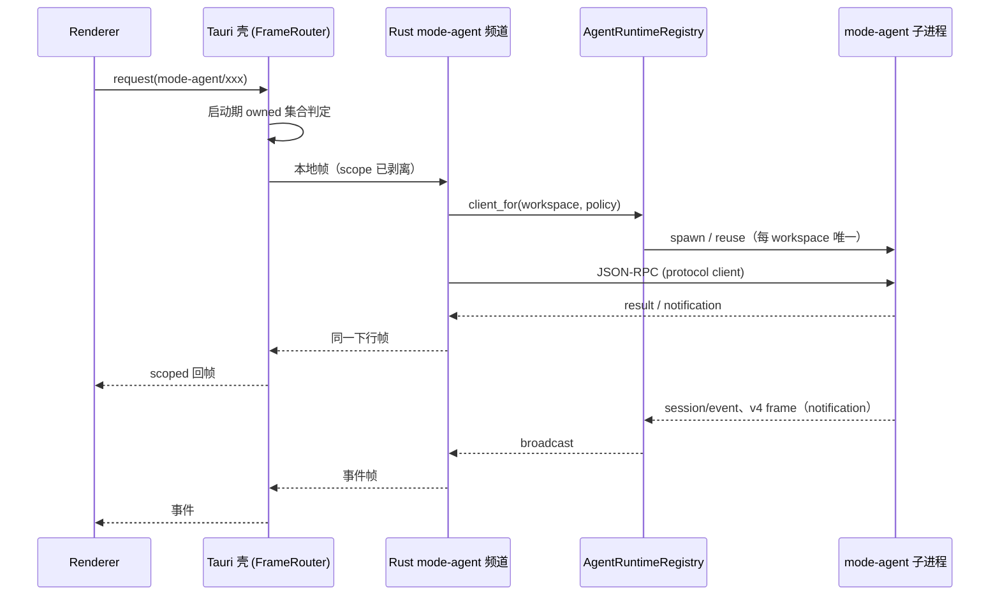

# Spec：Agent 频道所有权切换（W4 门槛）

状态：**草案（2026-11-01），待批准；本文件不改变运行时行为。**

关联：`docs/plans/2026-10-29-full-rust-rewrite.md`（W4）、
`docs/specs/agent-process.md`、`docs/specs/session-read-group.md`、
`docs/specs/session-write-group.md`、`docs/specs/agent-runtime-parity-matrix.md`。

## 1. 问题与结论

当前 `mode-agent` 频道由 Node Host 拥有：Host 拉起 `mode-agent` 子进程、
持有 115 个方法的路由与部分聚合状态。Rust 侧已经具备协议内核、进程层、
`AgentRuntimeRegistry` 与约 40 个方法，但**频道名只能整体切换**（`inprocess.rs`
按频道名在启动期分流），所以不能「半个 `mode-agent`」。

结论：

1. **切换粒度 = 频道，一次性、启动期决定**；不做运行时热切，不允许双所有者。
2. 切换前置 = 115 个方法里 **Renderer/Host 实际调用到的集合**全部有 Rust 实现，
   且未实现方法必须返回与 TS 一致的错误（不是静默空值）。
3. 切换前先交付**健康状态面**与**回滚开关**，否则无法判断「已接管但不可用」。
4. `mode-task`、`window-controller`、会话索引写路由等 Host 聚合面**不在本切片**；
   Rust 接管 `mode-agent` 后，Host 仍可通过自己的 RPC 调 Rust？**不做**——两者是
   并列服务面，Host 需要的 agent 能力必须经由同一 owner（见 §3 的事件顺序）。

## 2. 当前所有者

| 组件                                                                   | 所有者                          | 状态                        |
| ---------------------------------------------------------------------- | ------------------------------- | --------------------------- |
| 帧路由 / scoped 解复用                                                 | Tauri 壳 `inprocess.rs`         | 已实现，19 个频道可本地接管 |
| 45 个 Host 服务（含 `mode-agent` / `mode-task` / `window-controller`） | Node Host sidecar               | 现役                        |
| `mode-agent` 子进程                                                    | Node Host（`modeAgentService`） | 现役                        |
| agent 协议客户端、进程层、registry                                     | Rust `crates/agent-process`     | 已完成，未接线              |
| 会话/工作流/插件/附件只读协议                                          | Rust `crates/agent-protocol`    | 已覆盖大部分                |

**唯一性约束**：同一 workspace 只能有一个 Agent（`AgentRuntimeRegistry` 已保证）；
切换期间必须保证 Host 不再为该 workspace 拉起 Agent。启动期开关满足这一点，
运行时切换不满足。

## 3. 目标所有权与事件顺序

不变量：

1. **一个 workspace 一个 Agent**：由 registry key（`workspaceIdentity?.trim() || workspacePath`）
   与 owner/lease 维持；切换不改变 key 规则。
2. **请求与事件走同一下行路径**：`ChannelServer` 的响应/事件都经壳的 out queue，
   不允许 Rust 自己直连 Renderer。
3. **两条链路语义分开**：`desktop-continuous` 允许丢失中间态、以快照收敛；
   `web-remote-replayable` 必须保序、可重放。切换后由 Rust 的订阅 facade 承担，
   不能把 desktop 的缓冲策略套到 remote。
4. **控制帧仍归 Host**：`host` 频道（心跳、进程管理）不由壳接管；切换后 Host 仍是
   进程与窗口控制面的所有者。

## 4. 切换前置

### 4.1 方法覆盖矩阵

以 `IModeAgentService` 115 个方法为清单，逐项标记：

- `rust`：已有实现 + 测试；
- `not-needed`：Renderer/Host 不调用（需给出调用方证据）；
- `blocked`：依赖真实网络/凭据（provider/account），切换前必须决定降级语义。

门禁：`blocked` 为空，且 `rust` 覆盖所有 `not-needed` 之外的调用点。

**S1 工具已落（2026-11-01）**：`scripts/agent-method-coverage.ts` +
`docs/specs/agent-method-coverage.json`。

- `pnpm agent:coverage`（check）：清单与 interface 方法**双向**一致；`status=rust`
  必须在 `crates/agent-process/src` 找到对应 snake_case 函数；`not-needed` / `blocked`
  必须写 note；非法 status 直接失败。
- `pnpm agent:coverage:write`：重新检测 Rust 覆盖，保留人工标注的
  `not-needed` / `blocked` 与 note。
- 已接入 `verify:pre-push` 与 release verify。
- `pnpm agent:callsites` 生成 `docs/specs/agent-method-callsites.md`（Renderer/Desktop/
  Services/CLI 的调用点计数与最多 3 个例子）；计数是启发式，只作归类证据。
- 基线（2026-11-01）：115 个方法，`rust=91`、`blocked=14`、`todo=10`、`not-needed=0`。
  `blocked` 为宿主事件/反向请求与真实模型网络方法（note 已写明）；
  剩余 `todo` 集中在 automation 域、`initialize` 与
  `syncAppRuntimePreferences`。归类完成后才能把检查升级为「`todo` 必须为 0」的切换门禁。

### 4.2 健康状态面

新增只读状态（先由 Host 提供，切换后由壳/Rust 提供，形状不变）：

| 字段              | 含义                                       |
| ----------------- | ------------------------------------------ |
| `state`           | `starting` / `ready` / `degraded` / `dead` |
| `workspaceKey`    | 与 registry 同一 key                       |
| `runtimeIdentity` | `<workspaceKey>:<generation>:<pid>`        |
| `storageState`    | 复用现有 storage startup gate              |
| `lastError`       | 最近一次不可恢复错误（脱敏）               |

判定：

- `dead`：进程退出或 stdout 关闭（stdio 链路没有半开）；
- `starting`：进程已拉起但 storage gate 未 ready；
- `degraded`：gate ready 但最近一次请求因传输/超时失败，且进程仍存活；
- `ready`：gate ready 且无未解释的失败。

**S0 计算面已落（2026-11-01）**：`AgentRuntimeRegistry::health(&WorkspaceTarget)` 与
`AgentControlClient::runtime_health(&AgentWorkspaceTarget)`，返回
`{state, workspaceKey, runtimeIdentity, generation, processId, storageState, lastError}`；
没有条目时返回 `None`。判定：传输关闭或 storage gate 终态失败 → `dead`
（`lastError` 带 gate 错误）；非 storage 入口 → `ready`；gate 未 ready → `starting`。
`degraded` 需要请求失败计数，当前不产生。暴露位置（日志 / `host.describe`）仍待决策 3。
测试：`crates/agent-process/tests/health.rs`（3 条）。

**不做定时 ping**：本地 stdio 的存活由进程/管道事件判定；合成请求会污染
`pending` 与性能指标。若未来接远端 Agent（SSH/WSL），再单独定义心跳。

### 4.3 可观测与回滚

- 启动日志记录 `agent owner=rust|node`、registry generation、switch 环境变量值。
- 回滚：从 `MODE_HOST_INPROCESS_CHANNELS` 去掉 `mode-agent` 并重启；Host 重新成为
  owner。Rust 侧 registry 在 shutdown 时 `dispose_all`，不留孤儿进程。
- 切换观测：同一 workspace 连续两次启动必须只有一个 `mode-agent` 子进程；
  `taskkill`/正常退出后无残留。

## 5. 分阶段实施（每阶段独立可回滚）

| 阶段 | 内容                                                      | 出口                                   |
| ---- | --------------------------------------------------------- | -------------------------------------- |
| S0   | 健康状态面（只读，Host 提供）                             | UI/日志可见 owner 与 state，不影响行为 |
| S1   | 方法覆盖矩阵与 `blocked` 清零；未实现方法返回 TS 同款错误 | 矩阵检查脚本绿                         |
| S2   | `mode-agent` 频道适配器（默认不注册）+ 启动期开关         | 打开开关后 20 个真实任务通过           |
| S3   | Host 侧删除 `mode-agent` 所有权路径（保留回滚开关）       | 关闭开关仍全绿；无孤儿进程             |
| S4   | `hooks` grant、`mode-task`、会话索引写路由                | 对应 spec 验收                         |

S2 的 20 个真实任务与 parity matrix 是硬门禁（DR-07），不能压缩。

## 6. 待批准决策

1. **方法清单的 `not-needed` 证据由谁确认**：需要 Renderer/Host 调用点审计；
   建议在 S1 用脚本生成（方法名 → 调用文件/行），人工只审例外。
2. **`blocked` 方法的降级语义**：provider/account 网络方法在 Rust 未实现前，
   是返回 `unsupported` 还是继续委托 Host？本 spec 建议**不委托**（避免双 owner），
   由调用方在切换前明确降级文案。
3. **健康状态面的暴露位置**：新增 `host` 字段 / 独立只读频道 / 仅日志？建议先只写日志 +
   `host.describe` 扩展，避免新频道。
4. **Host 聚合面（`mode-task`）在 S2 之后如何读 agent 状态**：建议由 Renderer 分别调用
   两个 owner，Host 不反向调用 Rust；需要确认现有 `modeTaskServiceAdapter` 的耦合点。
5. **native binary 兜底**：是否在 S2 前补齐（当前只支持 `mode.cjs`）。建议 S2 后再做，
   因为切换不依赖它；但远端部署可能需要。

在上述决策批准前，`mode-agent` 频道保持 Host 所有，Rust 侧只继续补协议与方法实现。
