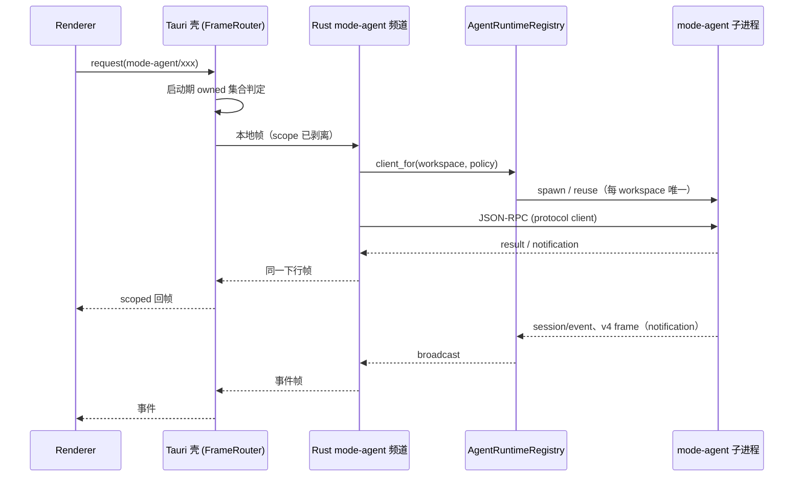

# Spec：Agent 频道所有权切换（W4 门槛）

状态：**已批准（2026-11-04），S2 实施中；本文件不改变运行时行为。**

关联：`docs/plans/2026-10-29-full-rust-rewrite.md`（W4）、
`docs/specs/agent-process.md`、`docs/specs/session-read-group.md`、
`docs/specs/session-write-group.md`、`docs/specs/agent-runtime-parity-matrix.md`。

## 1. 问题与结论

当前 `mode-agent` 频道由 Node Host 拥有：Host 拉起 `mode-agent` 子进程、
持有 115 个方法的路由与部分聚合状态。Rust 侧已经具备协议内核、进程层、
`AgentRuntimeRegistry` 与 102 个方法（2026-11-05 覆盖矩阵），但**频道名只能
整体切换**（`inprocess.rs` 按频道名在启动期分流），所以不能「半个 `mode-agent`」。

结论：

1. **切换粒度 = 频道，一次性、启动期决定**；不做运行时热切，不允许双所有者。
2. 切换前置 = 115 个方法里 **Renderer/Host 实际调用到的集合**全部有 Rust 实现，
   且未实现方法必须返回与 TS 一致的错误（不是静默空值）。
3. 切换前先交付**健康状态面**与**回滚开关**，否则无法判断「已接管但不可用」。
4. `mode-task`、`window-controller`、会话索引写路由等 Host 聚合面**不在本切片**；
   Rust 接管 `mode-agent` 后，Host 仍可通过自己的 RPC 调 Rust？**不做**——两者是
   并列服务面，Host 需要的 agent 能力必须经由同一 owner（见 §3 的事件顺序）。

## 2. 当前所有者

| 组件                                                                   | 所有者                          | 状态                        |
| ---------------------------------------------------------------------- | ------------------------------- | --------------------------- |
| 帧路由 / scoped 解复用                                                 | Tauri 壳 `inprocess.rs`         | 已实现，21 个频道可本地接管 |
| 45 个 Host 服务（含 `mode-agent` / `mode-task` / `window-controller`） | Node Host sidecar               | 现役                        |
| `mode-agent` 子进程                                                    | Node Host（`modeAgentService`） | 现役                        |
| agent 协议客户端、进程层、registry                                     | Rust `crates/agent-process`     | 已完成，未接线              |
| 会话/工作流/插件/附件只读协议                                          | Rust `crates/agent-protocol`    | 已覆盖大部分                |

**唯一性约束**：同一 workspace 只能有一个 Agent（`AgentRuntimeRegistry` 已保证）；
切换期间必须保证 Host 不再为该 workspace 拉起 Agent。启动期开关满足这一点，
运行时切换不满足。

## 3. 目标所有权与事件顺序

不变量：

1. **一个 workspace 一个 Agent**：由 registry key（`workspaceIdentity?.trim() || workspacePath`）
   与 owner/lease 维持；切换不改变 key 规则。
2. **请求与事件走同一下行路径**：`ChannelServer` 的响应/事件都经壳的 out queue，
   不允许 Rust 自己直连 Renderer。
3. **两条链路语义分开**：`desktop-continuous` 允许丢失中间态、以快照收敛；
   `web-remote-replayable` 必须保序、可重放。切换后由 Rust 的订阅 facade 承担，
   不能把 desktop 的缓冲策略套到 remote。
4. **控制帧仍归 Host**：`host` 频道（心跳、进程管理）不由壳接管；切换后 Host 仍是
   进程与窗口控制面的所有者。

## 4. 切换前置

### 4.1 方法覆盖矩阵

以 `IModeAgentService` 115 个方法为清单，逐项标记：

- `rust`：已有实现 + 测试；
- `not-needed`：Renderer/Host 不调用（需给出调用方证据）；
- `blocked`：依赖真实网络/凭据（provider/account），切换前必须决定降级语义。

门禁：`blocked` 为空，且 `rust` 覆盖所有 `not-needed` 之外的调用点。

**S1 工具已落（2026-11-01）**：`scripts/agent-method-coverage.ts` +
`docs/specs/agent-method-coverage.json`。

- `pnpm agent:coverage`（check）：清单与 interface 方法**双向**一致；`status=rust`
  必须在 `crates/agent-process/src` 找到对应 snake_case 函数；`not-needed` / `blocked`
  必须写 note；非法 status 直接失败。
- `pnpm agent:coverage:write`：重新检测 Rust 覆盖，保留人工标注的
  `not-needed` / `blocked` 与 note。
- 已接入 `verify:pre-push` 与 release verify。
- `pnpm agent:callsites` 生成 `docs/specs/agent-method-callsites.md`（Renderer/Desktop/
  Services/CLI 的调用点计数与最多 3 个例子）；计数是启发式，只作归类证据。
- 基线（2026-11-01）：115 个方法，`rust=91`、`blocked=24`、`todo=0`、`not-needed=0`。
- 当前（2026-11-05）：`rust=102`、`not-needed=11`、`blocked=2`、`todo=0`。`not-needed`
  为 automation 10（决策 4）与 `onDynamicLocalTtftFacts`（审计判定空事件）；`blocked`
  为 `generateWorkspaceText` / `testModelConnectivity`（决策 2 显式 `unsupported_method`）。
- 方法面口径：115 个方法 = 100 个请求方法 + 15 个事件方法；S2 请求面按 100 计。
- 检查已升级为「`todo` 必须为 0」；`blocked` 的降级语义已按决策 2 收敛。

### 4.2 健康状态面

新增只读状态（先由 Host 提供，切换后由壳/Rust 提供，形状不变）：

| 字段              | 含义                                       |
| ----------------- | ------------------------------------------ |
| `state`           | `starting` / `ready` / `degraded` / `dead` |
| `workspaceKey`    | 与 registry 同一 key                       |
| `runtimeIdentity` | `<workspaceKey>:<generation>:<pid>`        |
| `storageState`    | 复用现有 storage startup gate              |
| `lastError`       | 最近一次不可恢复错误（脱敏）               |

判定：

- `dead`：进程退出或 stdout 关闭（stdio 链路没有半开）；
- `starting`：进程已拉起但 storage gate 未 ready；
- `degraded`：gate ready 但最近一次请求因传输/超时失败，且进程仍存活；
- `ready`：gate ready 且无未解释的失败。

**S0 计算面已落（2026-11-01）**：`AgentRuntimeRegistry::health(&WorkspaceTarget)` 与
`AgentControlClient::runtime_health(&AgentWorkspaceTarget)`，返回
`{state, workspaceKey, runtimeIdentity, generation, processId, storageState, lastError}`；
没有条目时返回 `None`。判定：传输关闭或 storage gate 终态失败 → `dead`
（`lastError` 带 gate 错误）；非 storage 入口 → `ready`；gate 未 ready → `starting`。
`degraded` 需要请求失败计数，当前不产生。**决策 3 已落地（2026-11-04）**：健康面以独立只读频道 `agent-health` 暴露（`crates/host-channels/src/health.rs`，list/describe 两方法、只读不拉起），壳接线（inprocess 注册）随 S2 的 S0 翻面一起接。
测试：`crates/agent-process/tests/health.rs`（3 条）。

**不做定时 ping**：本地 stdio 的存活由进程/管道事件判定；合成请求会污染
`pending` 与性能指标。若未来接远端 Agent（SSH/WSL），再单独定义心跳。

### 4.3 可观测与回滚

- 启动日志记录 `agent owner=rust|node`、registry generation、switch 环境变量值。
- 回滚：从 `MODE_HOST_INPROCESS_CHANNELS` 去掉 `mode-agent` 并重启；Host 重新成为
  owner。Rust 侧 registry 在 shutdown 时 `dispose_all`，不留孤儿进程
  （2026-11-05：`RunEvent::Exit` 先 `shutdown_agents(2s)` 再收 Host；开关白名单
  已包含 `mcp-sync` / `agent-health` / `mode-agent`）。
- 切换观测：同一 workspace 连续两次启动必须只有一个 `mode-agent` 子进程；
  `taskkill`/正常退出后无残留。

## 5. 分阶段实施（每阶段独立可回滚）

| 阶段 | 内容                                                      | 出口                                   |
| ---- | --------------------------------------------------------- | -------------------------------------- |
| S0   | 健康状态面（只读，Host 提供） **已落地（2026-11-04）**：壳装配 `AgentRuntimeRegistry`+`AgentControlClient`（`agent_runtime.rs`，工厂完整实现启动规格解析），`agent-health` 频道进 inprocess 接管清单，启动日志 `agent owner=node (S0: agent-health read-only)` | UI/日志可见 owner 与 state，不影响行为 |
| S1   | 方法覆盖矩阵与 `blocked` 清零；未实现方法返回 TS 同款错误 | 矩阵检查脚本绿                         |
| S2   | `mode-agent` 频道适配器（默认不注册）+ 启动期开关 **实施中（2026-11-05）**：适配器已覆盖 88/100 请求面与全部 15 个事件面——会话只读/写组、sendPrompt、plugins（含 marketplace/cancelOperation）、workflows 六方法、生命周期/杂项、v4 帧/订阅/query 族、v4 命令转发（`sendConversationCommandV4`）、attachments、用量、process 遥测、TTFT 空事件、conversation telemetry、CUA 权限观察与 operation turn、连接流控、运行时偏好延迟应答、插件操作进度。剩余 automation 10（决策 4 改判 `not-needed`，Renderer 分调两个 owner）；provider/account 2 个网络方法按决策 2 返回显式 `unsupported_method`。壳内 inprocess 仅当开关显式包含 `mode-agent` 时注册。**已知保真缺口**：sendPrompt 的 `browserAmbientContext` 采集、createSession 的 Off-Peak 灰度 flag（动态工作流已支持 env 覆盖）仍待接；readSession 的 Account Config 预同步/`runtimePolicy`、mcp 与 create/resume/send 的 `unrecognized_keys` 重试已接（2026-11-05） | 打开开关后 20 个真实任务通过           |
| S3   | Host 侧删除 `mode-agent` 所有权路径（保留回滚开关）       | 关闭开关仍全绿；无孤儿进程             |
| S4   | `hooks` 频道（load/save/grant）**已落（2026-11-05）**；剩 `mode-task`、会话索引写路由 | hooks 真机开关验收；`mode-task` 对应 spec 验收 |

S2 的 20 个真实任务与 parity matrix 是硬门禁（DR-07），不能压缩。

## 6. 决策记录（2026-11-04 已批准，按「最彻底」口径）

1. **方法清单的 `not-needed` 证据由谁确认** — **已批准**：脚本生成调用点证据
   （`pnpm agent:callsites`）+ 人工只审例外；S1 收口时按脚本清单全量过一遍。
2. **`blocked` 方法的降级语义** — **已批准：不委托 Host**。provider/account
   网络方法在 Rust 未实现前返回显式 `unsupported` 语义（带降级文案），由调用方
   在切换前知晓；不引入双 owner。具体契约（2026-11-04 补）：
   `generateWorkspaceText` / `testModelConnectivity` 在 Rust 侧未实现前返回
   错误码 `unsupported_method`，文案「该方法依赖真实模型/网络与 provider 凭据，
   当前频道由 Rust 所有；如需使用，请把它从 `MODE_HOST_INPROCESS_CHANNELS`
   移除以回滚到 Node Host」；覆盖矩阵两方法的 blocked 注记已同步。
3. **健康状态面的暴露位置** — **已批准：独立只读频道**（`host.health` 面），
   而非仅日志：健康状态（含后续 `degraded` 请求失败计数）作为一等只读面暴露，
   Renderer/诊断页可直接订阅；不引入定时 ping，状态仍由事件驱动计算。
4. **Host 聚合面（`mode-task`）在 S2 之后如何读 agent 状态** — **已批准：由
   Renderer 分别调用两个 owner，Host 不反向调用 Rust**；S2 接线时同步梳理
   `modeTaskServiceAdapter` 的耦合点并拆到 Renderer 侧。
5. **native binary 兜底** — **已批准：S2 前补齐**。`agent-process` 启动规格在
   `mode.cjs` 之外先补 native binary 兜底与解析，再开始频道翻面，确保切换后
   不依赖 Node 运行时（远端部署同时受益）。

上述批准后：S2 按本 spec 的分阶段实施推进；automation 10 个 Host 聚合方法
已按决策 4 改判 `not-needed`（Renderer 分调两个 owner），宿主事件/反向请求 12 个
已随 S2 接线改判 `rust`，provider/account 2 个网络方法保持 `blocked` 并按决策 2
返回 `unsupported_method`。

决策已全部批准；`mode-agent` 频道在 S2 翻面前仍保持 Host 所有（Rust 适配器默认不注册），
翻面与回滚按 §5 执行。

## 7. S2 真机 20 任务验收清单（2026-11-05）

执行前提：`MODE_HOST_INPROCESS_CHANNELS` 显式包含 `mode-agent`；使用真实模型与
可用 workspace；记录写入 `.plan/accept-<版本>-s2/`（日志、截图、关键帧）。
**2026-11-05 补充**：壳侧已注入 `ProviderSource`，并升级为
`provider-account-facts`（设置/身份/缓存 Key/Coding Plan 可用性 + reqwest）；
新进程首次取 client 即交付。Personal API Key Provider 与已有 OAuth/JWT 的 Coding Plan
可验收；OAuth→API Key 与团队权益/团队 Key 已接；团队请求鉴权接线仍属 W3。

| # | 任务 | 覆盖方法 | 通过标准 |
| --- | --- | --- | --- |
| 1 | 新会话发送文本 | createSession/sendPrompt/readSession/readSessionMessages | 流式首 token、最终消息与 usage 一致；无 unsupported |
| 2 | 多轮上下文 + 中途停止 | sendPrompt/readSession | 停止后终态正确，下一轮上下文不丢 |
| 3 | 切换模型与思考档 | setModel/setThoughtLevel | 快照 model/thoughtLevel 立即生效，下一轮按新模型执行 |
| 4 | 切换会话模式 | setMode | 快照 mode 更新，工具行为随之变化 |
| 5 | 关闭后恢复会话 | closeSession/resumeSession/listSessions | 恢复历史完整，可继续发送 |
| 6 | 会话压缩 | compactSession | 摘要落库，后续轮次正常且 token 下降 |
| 7 | 文件读取工具 | sendPrompt/listSessions | 工具调用与结果出现在消息部件中 |
| 8 | 文件编辑 + 回滚预览 | conversationFileChangesV4/conversationFileRewindPreviewV4 | 变更清单与预览正确，无路径泄漏 |
| 9 | Bash 前台与后台输出 | backgroundBashOutputV4 | 前台完成；后台任务可按 workId 轮询到输出与终态 |
| 10 | 附件上传与预览 | attachmentBegin/Chunk/Commit/PreviewSource、conversationAttachmentRead/Stat | 图片可发送，预览/读取字节一致 |
| 11 | 计划模式产物 | conversationPlansV4 | ExitPlanMode 方案可见且行序正确 |
| 12 | Goal/Todo 生命周期 | goalSession | 创建/完成状态与快照一致 |
| 13 | conversation 订阅与重同步 | subscribeConversationV4/resyncConversationV4/unsubscribe | 首帧完整、增量有序；resync 后不重复不丢帧 |
| 14 | 历史分页 | conversationRowsRangeV4 | 向上翻页无重复行，边界 limit 正确 |
| 15 | workflow run 读面 | conversationWorkflowRuns/Events/Artifacts/ArtifactData/ArtifactRead/Workspace/NodeResult | 七组结果形状正确，artifact 字节可读 |
| 16 | 远程/重连语义 | subscribeSessionsIndexV4/subscribeWorkspaceConfigV4 + session events | `web-remote-replayable` 重连后补号、去重、快照一致 |
| 17 | MCP 列表与状态 | listMcpServerStatuses/listSessions | 状态/failureKind 正确，未知字段不导致失败 |
| 18 | 插件概览与开关 | getPluginsOverview/setPluginEnabled/configurePlugin/validatePlugin | 变更持久化，诊断信息完整 |
| 19 | Skills 目录与引用 | getSkillReferenceCatalog/resolveSuggestedPluginReference/getPluginReferenceCatalog | 条目 enabled 均为 true，引用解析成功 |
| 20 | 子代理与健康面 | listSessionSubagents/getWorkspaceRuntimeIdentity/agent-health list/describe | running/ended 正确；健康状态与 owner 日志一致 |

补充检查（不计入 20 个）：

- provider/account 两个网络方法返回 `unsupported_method` 与批准文案；从开关移除
  `mode-agent` 后同样任务全部回到 Node Host 且无回归。
- 桌面与手机 Web 各跑 1、13、16 三项；`desktop-continuous` 与
  `web-remote-replayable` 的快照/重连语义分别验证。
- 任务 1/9/10/15 结束后检查无孤儿 Agent/MCP 进程。
